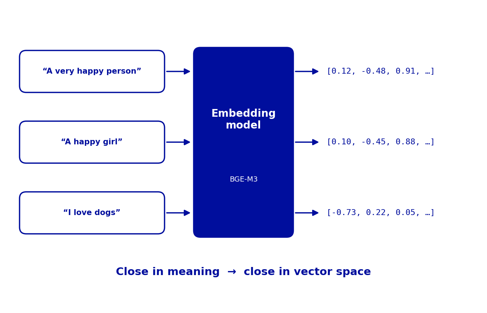
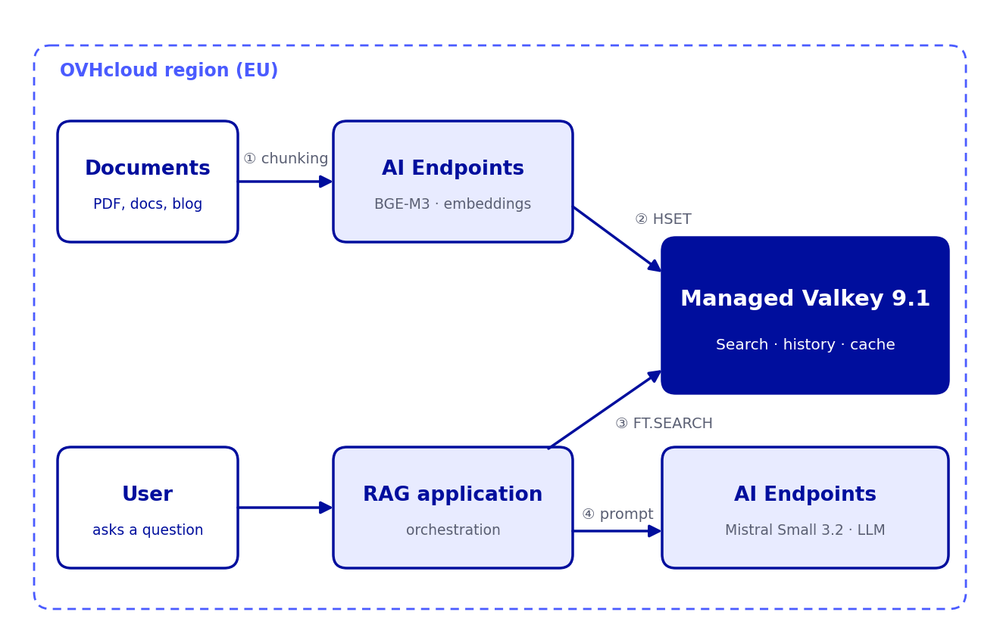
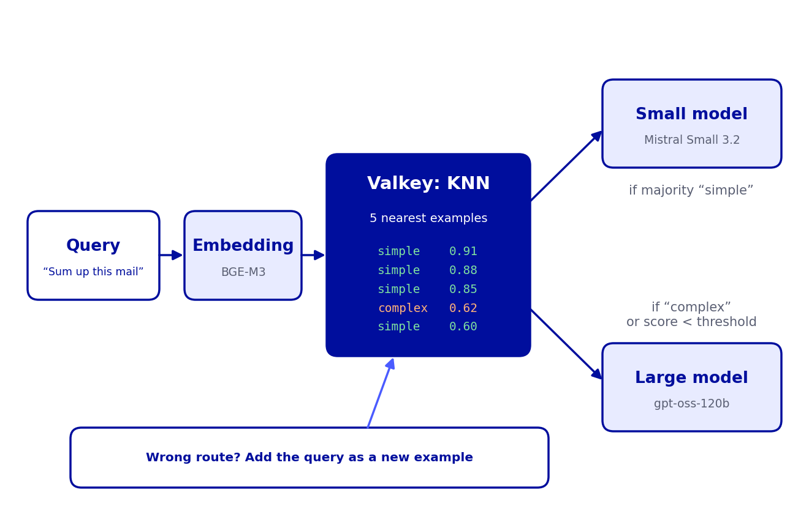
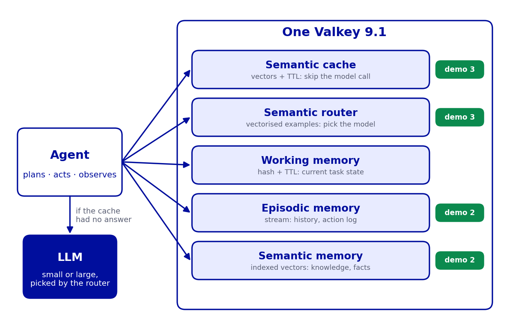

# Agenda
- Why talk about it again in 2026
- Valkey in three minutes
- Vector and hybrid search
- Sovereign RAG
- Cutting the LLM bill
- Valkey as agent memory
- In production
- Key takeaways & Q&A

Notes : 35 minutes, trois démos en live. La démo 1 tourne en local dans Docker (Valkey 9.1, même code que sur OVHcloud Managed Valkey) ; les démos 2 et 3 s'appuient sur AI Endpoints. Annoncer tout de suite que tout ce qu'on va voir tourne en Europe, sur des briques open source, et que le code est sur GitHub.

---

# Why talk about it again in 2026
<!-- number: 1 -->

Notes : Il y a trois ans, la recherche vectorielle était une nouveauté. En 2026, tout le monde a fait son POC RAG. La question a changé : comment passer en production, à coût maîtrisé, sans multiplier les briques.

---

# From 2020 to 2026: what changed

- 2020: Facebook AI (now Meta) publishes **RAG** (*Retrieval-Augmented Generation*): retrieve the information before generating the answer
- 2023: with ChatGPT, RAG goes mainstream (**LLM + vector database**), but mostly stays at the POC stage
- 2024: Redis changes its licence, **Valkey** is born at the Linux Foundation
- 2025: **agents** reach production, the number of LLM calls explodes
- 2026: the question is no longer "which model?" but **what cost, what latency, where is my data?**
- Valkey 9.1 + **Valkey Search 1.2**: text, filters and vectors in a single engine

Notes : Les concepts de base n'ont pas changé, la stack si. RAG = Retrieval-Augmented Generation : avant de répondre, on va chercher les documents pertinents et on les donne au LLM comme contexte ; on le détaille au chapitre 4. Le concept vient de la recherche (Lewis et al., Facebook AI / Meta AI, NeurIPS 2020) ; il explose en 2023, après ChatGPT, avec les frameworks LangChain et LlamaIndex. Un agent fait 5 à 30 appels par tâche : chaque milliseconde et chaque token comptent.

---

The bottleneck of AI in production is no longer the model. It is **hot data**: the data you need to find, filter and serve in a few milliseconds.

Notes : Laisser la phrase s'installer, puis : « Les trois démos qui suivent montrent cette donnée chaude dans Valkey : un catalogue, une base de connaissance, un cache de réponses. »

---

# Valkey in three minutes
<!-- number: 2 -->

---

# What is Valkey?

- **March 2024**: Redis drops its BSD open source licence
- **28 March 2024**, one week later: the Linux Foundation launches **Valkey**, a fork of Redis 7.2.4, the last open source version, under the **BSD-3** licence
- Backed from day one by **AWS, Google Cloud, Oracle, Ericsson**, with open, multi-vendor governance
- **Compatible**: same commands, same clients, same data structures
- Versions 8 and 9: multithreaded I/O, lower memory usage, improved cluster mode
- Available as a managed service: **OVHcloud Managed Valkey 9.1**

Notes : Redis annonce le 20 mars 2024 son passage sous licences RSAL/SSPL ; Valkey est lancé quelques jours plus tard, le 28 mars. Message clé pour l'audience : migrer depuis Redis OSS ne demande pas de changer de code. Pas de dépendance à un éditeur unique, c'est cohérent avec la logique de souveraineté du Summit.

---

# More than a cache: modules
<!-- layout: colonnes -->
<!-- numbers: no -->

## Valkey Search

Secondary indexes on your hashes (key → fields objects) and JSON documents: **full text, tags, numeric, vectors**. A single `FT.SEARCH` query.

## Valkey JSON

Native JSON documents, partial updates by path. Ideal for storing a business object and its embedding together.

## Valkey Bloom

Probabilistic filters: deduplication, "seen before?" in constant memory. Useful upstream of an ingestion pipeline.

Notes : Le module qui nous intéresse aujourd'hui, c'est Search. JSON et Bloom servent dans les démos en appui.

---

# Vector and hybrid search
<!-- number: 3 -->

---

# Refresher: from data to vector
<!-- layout: image -->

Images (demo 1): CLIP, 512 dimensions. Text (demos 2 and 3): BGE-M3 via AI Endpoints, 1024 dimensions.

Notes : Rester bref, la majorité de la salle connaît. Pour les images, la démo 1 utilise CLIP ViT-B/32, un modèle open source qui tourne en local : le catalogue AI Endpoints ne propose que des modèles d'embedding texte. CLIP place images et textes dans le même espace : on peut chercher une chaussure avec une photo ou avec une phrase. BGE-M3 est multilingue (plus de 100 langues, dont le français) et cross-lingue : une question en français retrouve un document en anglais, car les deux langues partagent le même espace vectoriel. Il accepte des textes longs (jusqu'à 8 192 tokens). Un modèle d'embedding transforme texte, image ou son en vecteur de nombres. Deux contenus proches en sens donnent deux vecteurs proches dans l'espace. On cherche par distance (cosinus, L2, produit scalaire), pas par mot-clé. L'exemple : « une personne très heureuse » et « une fille heureuse » sont proches, « j'aime les chiens » est loin.

---

# One index, four field types

- `TEXT`: full-text search (product name)
- `TAG`: exact filters (gender, type, colour)
- `NUMERIC`: ranges and sorting (price, stock)
- `VECTOR`: similarity, **HNSW** or **FLAT** algorithm (image embedding)
- The index **fills itself**: every hash written with `HSET`, existing or future, is indexed without a separate ingestion pipeline

Notes : Ce sont exactement les champs de la démo 1 : FT.CREATE idx:products ON HASH PREFIX 1 product: SCHEMA name TEXT gender TAG category TAG color TAG price NUMERIC stock NUMERIC embedding VECTOR HNSW … DIM 512 DISTANCE_METRIC COSINE. Rappel : un hash, c'est un objet stocké sous une clé avec plusieurs champs, par exemple product:42 avec name, price, stock et embedding. HSET est la commande qui écrit ou met à jour ces champs. C'est le point différenciant : on indexe la donnée là où elle vit déjà. Pas de synchronisation vers un moteur de recherche externe, donc pas de décalage entre le cache et l'index.

---

# HNSW or FLAT?

## FLAT: exact
- Compares the query with **every** vector: **KNN** search (*k-nearest neighbors*)
- **Always** finds the true nearest neighbours
- Cost grows with volume: for small datasets

## HNSW: approximate
- Walks a **neighbourhood graph**, without comparing everything
- Finds **over 99%** of the true nearest neighbours, in a few milliseconds over millions of vectors
- The default choice in production

Notes : Le « rappel » (recall) mesure la part des vrais plus proches voisins effectivement retrouvés. FLAT est exact par construction : 100 %. HNSW échange une petite perte de précision (souvent moins de 1 %) contre une recherche beaucoup plus rapide ; les paramètres M et EF_RUNTIME règlent ce compromis. Même syntaxe de requête dans les deux cas, seul l'index change. On peut créer un second index HNSW sur le même préfixe de clés pendant que le premier continue de servir le trafic.

---

# Demo 1: visual and hybrid search
<!-- theme: dark -->

- **3,000 shoes**, each in a Valkey 9.1 hash with its embedding
- **CLIP** image embeddings (open source, 512 dimensions), **HNSW** index
- "Find me shoes that look like this one"
- Then **the same query, filtered** by gender, price and stock, in a single round trip
- One `HSET` marks a product out of stock: it instantly disappears from the results
- Bonus: a photo taken on stage, or a description in French

Notes : DÉMO LIVE (6 min), en local dans Docker : même code que sur OVHcloud Managed Valkey (make up TARGET=ovh). Déroulé : 0:00 catalogue, « un produit = un simple hash ». 0:45 (optionnel) terminal, FT.INFO idx:products : l'index s'est rempli tout seul. 1:30 clic sur une basket homme : scores de similarité et commande *=>[KNN 12 …] avec la latence. 2:30 Mode hybride, Femme, prix max 100 €, En stock : filtres + KNN dans une seule requête. 3:45 bouton Rupture sur le premier résultat : un HSET, le produit disparaît, sans réindexation. 4:30 photo glissée ou « baskets rouges pour courir » : image et texte dans le même espace. Si le temps le permet, onglet « Comment ça marche », étapes 4 (espace vectoriel), 6 (entonnoir des filtres) et 7 (HNSW), environ 2 min. Avant de monter : make reset puis make up OFFLINE=1. Plan B : captures d'écran du dossier plan-b.

---

## 0.6 ms
median hybrid search time (filters + KNN) over the 3,000 demo products, measured locally. Response time is decided by the network, not by the search.

Notes : Chiffre relevé par make check sur la démo 1 (médiane 0,6 ms, max 0,9 ms, aller-retour compris, Valkey local dans Docker). Ne pas extrapoler : sur un service managé, ajouter la latence réseau entre l'application et Valkey. Le message : la recherche vectorielle filtrée n'est pas le goulot d'étranglement.

---

# Sovereign RAG
<!-- number: 4 -->

---

# RAG in one sentence

- **R**etrieval: find the documents relevant to the question
- **A**ugmented: add them to the prompt as context
- **G**eneration: the LLM answers **from your data**, not only from what it learned
- Result: up-to-date, sourced answers, without retraining the model

Notes : Référence si la question vient : « Retrieval-Augmented Generation for Knowledge-Intensive NLP Tasks », Patrick Lewis et al., Facebook AI, UCL et NYU, NeurIPS 2020 (arXiv 2005.11401). Pourquoi c'est devenu le standard : le fine-tuning coûte cher, fige la connaissance à une date et expose les données sensibles à l'entraînement. Avec le RAG, la connaissance reste dans la base, mise à jour en continu, et on peut filtrer par droits d'accès. La qualité de la réponse dépend surtout de la qualité de la récupération : c'est là que Valkey intervient.

---

# RAG architecture
<!-- layout: image -->

Everything runs in one OVHcloud region: no data leaves the EU.

Notes : Dérouler les 4 étapes : (1) ingestion, documents découpés et vectorisés par BGE-M3 ; (2) stockage en HSET, indexation automatique ; (3) récupération par recherche hybride, sens + filtres métier ; (4) génération par un LLM open source via AI Endpoints. Toute la chaîne tourne sur OVHcloud avec des modèles ouverts. AI Endpoints expose une API compatible OpenAI : changer de modèle, c'est changer une chaîne de caractères.

---

# Why Valkey for RAG?
<!-- layout: colonnes -->
<!-- numbers: no -->

## Freshness

A modified document is reindexed on write. No nightly batch, no answer based on an outdated version.

## Precision

**Hybrid** search: meaning through vectors, business rules through filters (access rights, language, date).

## Context

The same Valkey keeps the **conversation history** and user sessions, with automatic expiry.

Notes : Le filtre de droits d'accès est souvent oublié dans les POC RAG. Ici, c'est un simple TAG dans la même requête.

---

# Demo 2: an end-to-end RAG assistant
<!-- theme: dark -->

- Knowledge base: product documentation and blog posts
- **BGE-M3** embeddings and **Mistral Small 3.2** generation via AI Endpoints
- Natural language question, **sourced** answer
- Conversation history stored in Valkey

Notes : DÉMO LIVE (7 min). Astuce : poser la question en français sur une documentation en anglais pour montrer le côté cross-lingue de BGE-M3. 1) Montrer le nombre de chunks indexés (FT.INFO). 2) Poser une question, afficher les sources récupérées et leur score. 3) Question de suivi qui s'appuie sur l'historique. 4) Comparer avec une recherche plein texte seule qui ne trouve rien sur une question formulée en langage naturel.

---

# Cutting the LLM bill
<!-- number: 5 -->

---

# Two caches, two uses

## Exact cache
The same query, character for character, returns the stored answer. Simple, but rare in natural language.

## Semantic cache
A question **close in meaning** to one already asked returns the existing answer. A fraction of a second, **zero tokens** consumed.

Notes : « Comment réinitialiser mon mot de passe ? » et « J'ai oublié mon mot de passe, que faire ? » : cache exact = deux appels LLM, cache sémantique = un seul. Le seuil de similarité est le réglage clé : trop bas, on renvoie de mauvaises réponses.

---

# Semantic routing: the right model for each query

- A corpus of **simple** and **complex** example queries, vectorised in Valkey
- Each new query is compared with the corpus using **KNN**
- Simple query: fast, cheap **small model**
- Complex query: **large model**
- A routing mistake? Add an example, no retraining needed

Notes : Même brique technique que le cache sémantique : un index vectoriel et une recherche des plus proches voisins. Pas de classifieur à entraîner, pas de moteur de règles.

---

# How routing works
<!-- layout: image -->

The k nearest examples vote: the majority picks the model.

Notes : Étape par étape. 1) La requête est vectorisée avec le même modèle d'embedding que le corpus. 2) Valkey renvoie les k exemples les plus proches (ici 5) avec leur étiquette « simple » ou « complexe » et leur score. 3) Vote majoritaire, éventuellement pondéré par le score. 4) Garde-fou : si le meilleur score est sous un seuil, la requête ne ressemble à rien de connu, on l'envoie par prudence au grand modèle. 5) Boucle de feedback : un utilisateur insatisfait ou une erreur détectée, on ajoute la requête au corpus avec la bonne étiquette, effet immédiat sans réentraînement.

---

## 35x
faster: a rephrased question served by the semantic cache answers in 0.2 s instead of 7 s, with no tokens paid. Measured on demo 3 with AI Endpoints.

Notes : Mesures de la démo 3 : première question 6,9 s avec Mistral Small 3.2, reformulation servie par le cache en 0,19 s (dont ~1 ms dans Valkey, le reste pour vectoriser la question avec BGE-M3). Côté prix, sur AI Endpoints l'écart entre Mistral Small 3.2 (0,09 € / 0,28 € par million de tokens) et gpt-oss-120b (0,08 € / 0,40 €) est faible : le routage fait surtout gagner en latence et en tokens de réflexion. Pour des modèles plus éloignés, l'écart grandit : Qwen3.5-397B est à 3,60 € par million de tokens de sortie, soit 13 fois Mistral Small. Le gros gain financier vient du cache. Prix relevés sur la page des prix OVHcloud (octobre 2026, HT).

---

# Demo 3: semantic caching and routing
<!-- theme: dark -->

- A question asked for the first time: LLM call, latency in seconds
- A **rephrasing** of the same question: answered by the cache in 0.2 s instead of 7 s, ~1 ms of it in Valkey
- A simple question routed to **Mistral Small**, a complex one to **gpt-oss-120b**
- Live counter: tokens and euros saved

Notes : DÉMO LIVE (6 min). Afficher le score de similarité et le seuil. Montrer un cas limite où le score est juste sous le seuil, pour expliquer le réglage.

---

# Valkey as agent memory
<!-- number: 6 -->

---

# Three memories for an agent
<!-- layout: colonnes -->
<!-- numbers: no -->

## Working memory

The state of the current task in a **hash with a TTL**. Read and written at every turn, in under a millisecond.

## Episodic memory

The log of actions and tool calls in a **stream**. Replayable, auditable, shareable between agents.

## Semantic memory

Learned facts and preferences, **vectorised and indexed**. Recalled by similarity at the right time.

Notes : Un agent sans mémoire repose les mêmes questions et refait les mêmes appels. Valkey couvre les trois besoins dans un seul service, avec les structures de données qu'on connaît déjà.

---

# One agent, one Valkey
<!-- layout: image -->

The cache, the router and two of the memories: you saw them in demos 2 and 3.

Notes : Faire le lien explicitement : « Vous avez déjà vu ces briques en action. Le cache sémantique et le routeur dans la démo 3, l'historique de conversation (un stream, donc une mémoire épisodique) et la base de connaissance (des vecteurs, donc une mémoire sémantique) dans la démo 2. Un agent, c'est l'assemblage de tout ça, dans un seul Valkey. » Seule la mémoire de travail n'a pas été montrée : c'est un hash avec un TTL, exactement comme une entrée du cache. Le point commun technique : cache, mémoire sémantique et routeur font la même opération, un KNN dans Valkey ; seuls changent le contenu de l'index et ce qu'on fait du résultat (renvoyer une réponse, enrichir le contexte, choisir le modèle). Le routage prend tout son sens pour un agent : il enchaîne 5 à 30 appels par tâche, la plupart simples. Option si on a de l'avance (1 min) : terminal de la démo 2, XRANGE chat:<id> - + pour montrer l'historique dans le stream. Plusieurs agents peuvent aussi se coordonner via streams et pub/sub, et Valkey peut être exposé comme outil à l'agent via un serveur MCP.

---

# Who decides what to fetch?

| Component | When | Triggered by | Valkey access |
|---|---|---|---|
| Semantic cache | before every LLM call | the code (middleware) | `FT.SEARCH` KNN + threshold |
| Working memory | at every turn | the code, by session key | `HGETALL session:<id>` |
| Episodic memory | resume, audit, another agent | the code or an agent | `XRANGE` / `XREAD` |
| Semantic memory | when context is missing | the agent, through a tool | `FT.SEARCH` KNN + user filter |
| Router | before every model call | the code | `FT.SEARCH` KNN 5 on examples |

The agent does not "guess": systematic lookups are **coded**, occasional recalls are **tools** it calls.

Notes : Point important pour démystifier. Le cache et la mémoire de travail ne dépendent pas du LLM : c'est l'orchestrateur qui les lit à chaque tour, avec des clés préfixées par utilisateur et par session, donc pas de mélange entre clients. La mémoire sémantique est exposée comme un outil (recall, remember), par exemple via un serveur MCP : c'est le LLM qui décide de l'appeler quand il lui manque une information, comme il déciderait d'appeler une API. La mémoire épisodique sert surtout à reprendre une tâche interrompue et à auditer ce que l'agent a fait.

---

# In production
<!-- number: 7 -->

---

# Sizing memory

Raw size = **number of vectors × dimensions × 4 bytes**. The number depends on your data, the dimension on the chosen model.

| Vectors (documents or chunks) | Embedding model | Dimensions | Raw size |
|---|---|---|---|
| 1 million | all-MiniLM-L6-v2 | 384 | ≈ 1.5 GB |
| 1 million | BGE-M3 | 1024 | ≈ 4.1 GB |
| 10 million | BGE-M3 | 1024 | ≈ 41 GB |

Also plan for the **HNSW graph**, the keys, the indexed fields and headroom for replicas.

Notes : Estimer le nombre de vecteurs. Pour un catalogue : un vecteur par objet (produit, image), multiplié par le nombre de champs vectorisés. Pour du texte : nombre de vecteurs ≈ volume total en tokens / (taille de chunk - recouvrement). Repères : une page de texte fait environ 500 à 700 tokens, un chunk courant fait 300 à 800 tokens. Exemple : 10 000 documents de 5 pages, soit environ 25 millions de tokens, découpés en chunks de 500 tokens avec 50 de recouvrement, donnent 25 000 000 / 450 ≈ 55 000 vecteurs, soit environ 230 Mo avec BGE-M3. On compte large : historique de conversation, cache sémantique et mémoire d'agent ajoutent leurs propres vecteurs. Deux paramètres indépendants. Le nombre de vecteurs, c'est le nombre de morceaux de texte (chunks) ou d'objets indexés : un catalogue d'un million de produits, ou 50 000 documents découpés en 20 chunks. La dimension est fixée par le modèle d'embedding : 384 pour un petit modèle comme all-MiniLM-L6-v2, 1024 pour BGE-M3. Chaque dimension est un float32, soit 4 octets. Exemple : 1 million × 1024 × 4 = 4,1 Go. Passer de 1024 à 384 dimensions divise la mémoire par 2,7, au prix d'une qualité de recherche parfois moindre, surtout en multilingue.

---

# Valkey, OpenSearch or pgvector?

| | Valkey | OpenSearch | pgvector |
|---|---|---|---|
| Data lives… | in memory, with the cache | in a dedicated search engine | in your PostgreSQL tables |
| Strength | latency, real time, TTL | full-text relevance, analytics | SQL, joins, transactions |
| Volume | bounded by RAM | very large volumes, on disk | that of the database |
| Best for | semantic cache, sessions, agent memory | search engine, logs, large RAG corpora | RAG on existing business data |

Not a replacement: choose based on **where the data lives** and **the target latency**. Often, all three coexist.

Notes : Question attendue, autant y répondre avant qu'on la pose. OpenSearch reste le meilleur choix pour un vrai moteur de recherche : analyseurs linguistiques, scoring BM25 avancé, agrégations, corpus qui ne tiennent pas en RAM. pgvector est imbattable quand la donnée est déjà dans PostgreSQL et qu'on veut filtrer avec du SQL et des jointures dans la même transaction. Valkey prend l'avantage sur la donnée chaude : millisecondes, mises à jour en continu, expiration automatique, et le même service sert de cache, de cache sémantique et de mémoire d'agent. Exemple d'architecture fréquente : PostgreSQL comme source de vérité, Valkey pour le chemin chaud et le cache sémantique, OpenSearch pour la recherche documentaire profonde.

---

# Best practices

- **TTL** on caches and working memory: what is no longer used leaves on its own
- **Similarity threshold** measured on your data, not copied from a tutorial
- **Replicas** for high availability and reads
- **Version** the index and the embedding model together: changing the model means reindexing
- Measure the semantic cache **hit rate** and search **result quality** on a reference set of questions

Notes : Le piège classique : changer de modèle d'embedding sans recalculer les vecteurs existants. Les deux espaces vectoriels ne sont pas compatibles.

---

# Key takeaways
<!-- layout: colonnes -->
<!-- numbers: no -->

## One engine

Cache, hybrid search, semantic cache and agent memory in the same Valkey.

## Fewer tokens

Semantic caching and routing cut latency and the LLM bill, without changing models.

## Open and sovereign

Valkey under the Linux Foundation, open models on AI Endpoints, data hosted in Europe.

Notes : Donner le lien vers le repo des démos. Inviter à passer au stand pour rejouer les démos.

---

# Replay the demos
<!-- layout: image-texte -->
<!-- fit: contain -->
<!-- kicker: Source code -->

- The three demos: code, Docker Compose and step-by-step guide
- **Local** in one command: `make prepare && make up`
- **OVHcloud** (Managed Valkey + AI Endpoints) and **Aiven** targets ready
- github.com/pvr-aiven/ovhsummit2006-valkey-ai

Notes : Laisser la slide quelques secondes pour que la salle scanne le QR code. Rappeler que tout tourne en local avec Docker, et qu'il suffit de changer de cible pour passer sur OVHcloud ou Aiven.

---

# Thank you!
Demo code: github.com/pvr-aiven/ovhsummit2006-valkey-ai. Come and talk to us at the booth.
<!-- layout: fin -->
