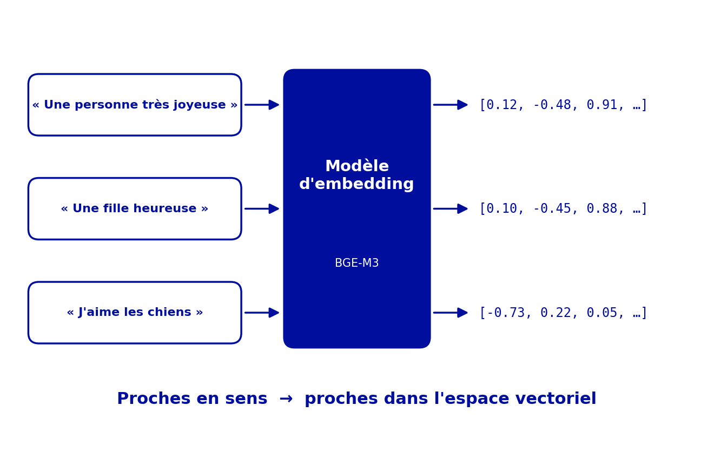
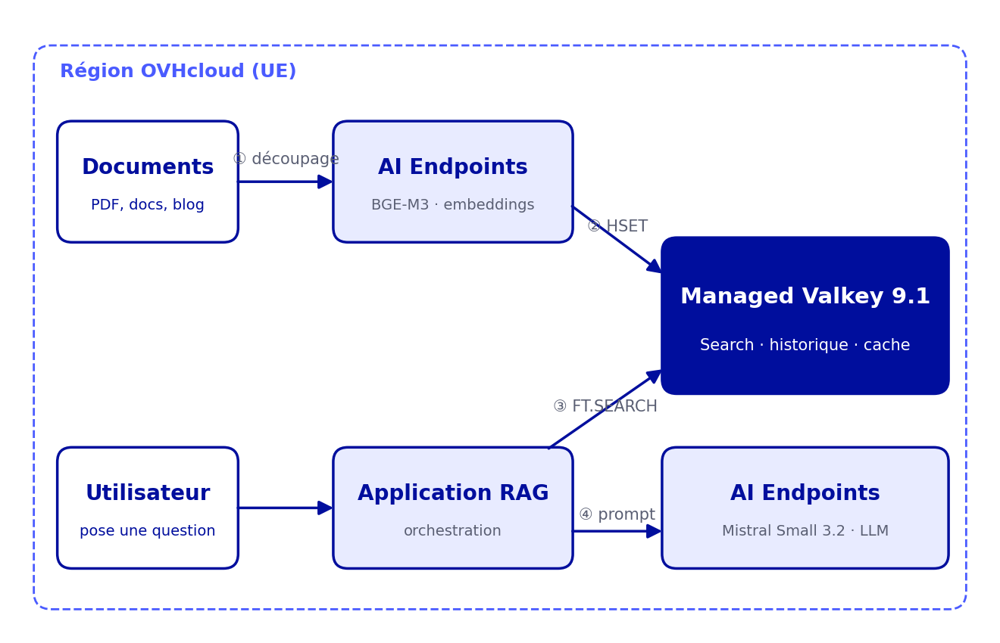
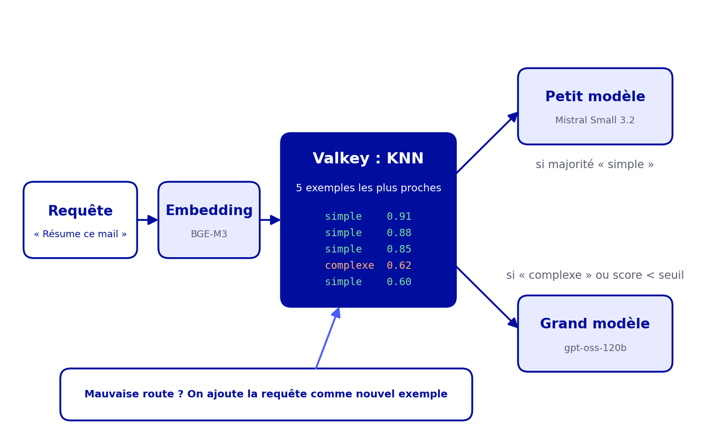
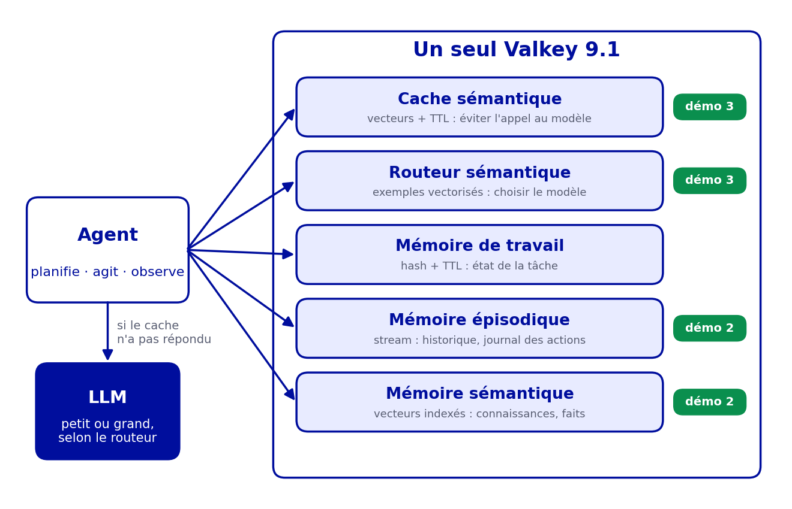

# Agenda
- Pourquoi en reparler en 2026
- Valkey en trois minutes
- Recherche vectorielle et hybride
- RAG souverain
- Réduire la facture LLM
- Valkey, mémoire des agents
- En production
- À retenir & Q/R

Notes : 35 minutes, trois démos en live. La démo 1 tourne en local dans Docker (Valkey 9.1, même code que sur OVHcloud Managed Valkey) ; les démos 2 et 3 s'appuient sur AI Endpoints. Annoncer tout de suite que tout ce qu'on va voir tourne en Europe, sur des briques open source, et que le code est sur GitHub.

---

# Pourquoi en reparler en 2026
<!-- number: 1 -->

Notes : Il y a trois ans, la recherche vectorielle était une nouveauté. En 2026, tout le monde a fait son POC RAG. La question a changé : comment passer en production, à coût maîtrisé, sans multiplier les briques.

---

# De 2020 à 2026 : ce qui a changé

- 2020 : Facebook AI (aujourd'hui Meta) publie le **RAG** (*Retrieval-Augmented Generation*) : chercher l'information avant de générer la réponse
- 2023 : avec ChatGPT, le RAG se démocratise (**LLM + base vectorielle**), mais reste surtout au stade du POC
- 2024 : changement de licence Redis, naissance de **Valkey** à la Linux Foundation
- 2025 : les **agents** arrivent en production, le nombre d'appels LLM explose
- 2026 : la question n'est plus « quel modèle ? » mais **quel coût, quelle latence, où sont mes données ?**
- Valkey 9.1 + **Valkey Search 1.2** : texte, filtres et vecteurs dans un seul moteur

Notes : Les concepts de base n'ont pas changé, la stack si. RAG = Retrieval-Augmented Generation : avant de répondre, on va chercher les documents pertinents et on les donne au LLM comme contexte ; on le détaille au chapitre 4. Le concept vient de la recherche (Lewis et al., Facebook AI / Meta AI, NeurIPS 2020) ; il explose en 2023, après ChatGPT, avec les frameworks LangChain et LlamaIndex. Un agent fait 5 à 30 appels par tâche : chaque milliseconde et chaque token comptent.

---

Le goulot d'étranglement de l'IA en production n'est plus le modèle. C'est **la donnée chaude** : celle qu'il faut retrouver, filtrer et servir en quelques millisecondes.

Notes : Laisser la phrase s'installer, puis : « Les trois démos qui suivent montrent cette donnée chaude dans Valkey : un catalogue, une base de connaissance, un cache de réponses. »

---

# Valkey en trois minutes
<!-- number: 2 -->

---

# Valkey, c'est quoi ?

- **Mars 2024** : Redis abandonne sa licence open source BSD
- **28 mars 2024**, une semaine plus tard : la Linux Foundation lance **Valkey**, fork de Redis 7.2.4, la dernière version open source, sous licence **BSD-3**
- Soutenu dès le départ par **AWS, Google Cloud, Oracle, Ericsson**, gouvernance ouverte et multi-fournisseurs
- **Compatible** : mêmes commandes, mêmes clients, mêmes structures de données
- Versions 8 et 9 : multithreading des I/O, réduction mémoire, mode cluster amélioré
- Disponible en service managé : **OVHcloud Managed Valkey 9.1**

Notes : Redis annonce le 20 mars 2024 son passage sous licences RSAL/SSPL ; Valkey est lancé quelques jours plus tard, le 28 mars. Message clé pour l'audience : migrer depuis Redis OSS ne demande pas de changer de code. Pas de dépendance à un éditeur unique, c'est cohérent avec la logique de souveraineté du Summit.

---

# Plus qu'un cache : les modules
<!-- layout: colonnes -->
<!-- numbers: no -->

## Valkey Search

Index secondaires sur vos hashes (objets clé → champs) et documents JSON : **texte intégral, tags, numérique, vecteurs**. Une seule requête `FT.SEARCH`.

## Valkey JSON

Documents JSON natifs, mise à jour partielle par chemin. Idéal pour stocker un objet métier et son embedding ensemble.

## Valkey Bloom

Filtres probabilistes : dédoublonnage, « déjà vu ? » en mémoire constante. Utile en amont d'un pipeline d'ingestion.

Notes : Le module qui nous intéresse aujourd'hui, c'est Search. JSON et Bloom servent dans les démos en appui.

---

# Recherche vectorielle et hybride
<!-- number: 3 -->

---

# Rappel : d'une donnée à un vecteur
<!-- layout: image -->

Images (démo 1) : CLIP, 512 dimensions. Textes (démos 2 et 3) : BGE-M3 via AI Endpoints, 1024 dimensions.

Notes : Rester bref, la majorité de la salle connaît. Pour les images, la démo 1 utilise CLIP ViT-B/32, un modèle open source qui tourne en local : le catalogue AI Endpoints ne propose que des modèles d'embedding texte. CLIP place images et textes dans le même espace : on peut chercher une chaussure avec une photo ou avec une phrase. BGE-M3 est multilingue (plus de 100 langues, dont le français) et cross-lingue : une question en français retrouve un document en anglais, car les deux langues partagent le même espace vectoriel. Il accepte des textes longs (jusqu'à 8 192 tokens). Un modèle d'embedding transforme texte, image ou son en vecteur de nombres. Deux contenus proches en sens donnent deux vecteurs proches dans l'espace. On cherche par distance (cosinus, L2, produit scalaire), pas par mot-clé. L'exemple : « une personne très heureuse » et « une fille heureuse » sont proches, « j'aime les chiens » est loin.

---

# Un index, quatre types de champs

- `TEXT` : recherche plein texte (nom du produit)
- `TAG` : filtres exacts (genre, type, couleur)
- `NUMERIC` : intervalles et tri (prix, stock)
- `VECTOR` : similarité, algorithme **HNSW** ou **FLAT** (embedding de l'image)
- L'index se **remplit tout seul** : chaque hash écrit avec `HSET`, déjà présent ou futur, est indexé sans pipeline d'ingestion séparé

Notes : Ce sont exactement les champs de la démo 1 : FT.CREATE idx:products ON HASH PREFIX 1 product: SCHEMA name TEXT gender TAG category TAG color TAG price NUMERIC stock NUMERIC embedding VECTOR HNSW … DIM 512 DISTANCE_METRIC COSINE. Rappel : un hash, c'est un objet stocké sous une clé avec plusieurs champs, par exemple product:42 avec name, price, stock et embedding. HSET est la commande qui écrit ou met à jour ces champs. C'est le point différenciant : on indexe la donnée là où elle vit déjà. Pas de synchronisation vers un moteur de recherche externe, donc pas de décalage entre le cache et l'index.

---

# HNSW ou FLAT ?

## FLAT : exact
- Compare la requête à **tous** les vecteurs : recherche **KNN** (*k-nearest neighbours*, les k plus proches voisins)
- Trouve **toujours** les vrais plus proches voisins
- Coût proportionnel au volume : pour les petits jeux de données

## HNSW : approché
- Parcourt un **graphe de voisinage**, sans tout comparer
- Retrouve **plus de 99 %** des vrais plus proches voisins, en quelques millisecondes sur des millions de vecteurs
- Le choix par défaut en production

Notes : Le « rappel » (recall) mesure la part des vrais plus proches voisins effectivement retrouvés. FLAT est exact par construction : 100 %. HNSW échange une petite perte de précision (souvent moins de 1 %) contre une recherche beaucoup plus rapide ; les paramètres M et EF_RUNTIME règlent ce compromis. Même syntaxe de requête dans les deux cas, seul l'index change. On peut créer un second index HNSW sur le même préfixe de clés pendant que le premier continue de servir le trafic.

---

# Démo 1 : recherche visuelle et hybride
<!-- theme: dark -->

- **3 000 chaussures**, chacune dans un hash Valkey 9.1 avec son embedding
- Embeddings d'images **CLIP** (open source, 512 dimensions), index **HNSW**
- « Trouve-moi des chaussures qui ressemblent à celle-ci »
- Puis **la même requête, filtrée** par genre, prix et stock, en un seul aller-retour
- Un `HSET` met un produit en rupture : il disparaît aussitôt du résultat
- Bonus : une photo prise sur scène, ou une description en français

Notes : DÉMO LIVE (6 min), en local dans Docker : même code que sur OVHcloud Managed Valkey (make up TARGET=ovhcloud). Déroulé : 0:00 catalogue, « un produit = un simple hash ». 0:45 (optionnel) terminal, FT.INFO idx:products : l'index s'est rempli tout seul. 1:30 clic sur une basket homme : scores de similarité et commande *=>[KNN 12 …] avec la latence. 2:30 Mode hybride, Femme, prix max 100 €, En stock : filtres + KNN dans une seule requête. 3:45 bouton Rupture sur le premier résultat : un HSET, le produit disparaît, sans réindexation. 4:30 photo glissée ou « baskets rouges pour courir » : image et texte dans le même espace. Si le temps le permet, onglet « Comment ça marche », étapes 4 (espace vectoriel), 6 (entonnoir des filtres) et 7 (HNSW), environ 2 min. Avant de monter : make reset puis make up TARGET=local-offline. Plan B : captures d'écran du dossier plan-b.

---

## 0,6 ms
médiane d'une recherche hybride (filtres + KNN) sur les 3 000 produits de la démo, mesurée en local. Le temps de réponse se joue sur le réseau, pas dans la recherche.

Notes : Chiffre relevé par make check sur la démo 1 (médiane 0,6 ms, max 0,9 ms, aller-retour compris, Valkey local dans Docker). Ne pas extrapoler : sur un service managé, ajouter la latence réseau entre l'application et Valkey. Le message : la recherche vectorielle filtrée n'est pas le goulot d'étranglement.

---

# RAG souverain
<!-- number: 4 -->

---

# Le RAG en une phrase

- **R**etrieval : retrouver les documents pertinents pour la question
- **A**ugmented : les ajouter au prompt comme contexte
- **G**eneration : le LLM répond **à partir de vos données**, pas seulement de ce qu'il a appris
- Résultat : des réponses à jour, sourcées, sans réentraîner le modèle

Notes : Référence si la question vient : « Retrieval-Augmented Generation for Knowledge-Intensive NLP Tasks », Patrick Lewis et al., Facebook AI, UCL et NYU, NeurIPS 2020 (arXiv 2005.11401). Pourquoi c'est devenu le standard : le fine-tuning coûte cher, fige la connaissance à une date et expose les données sensibles à l'entraînement. Avec le RAG, la connaissance reste dans la base, mise à jour en continu, et on peut filtrer par droits d'accès. La qualité de la réponse dépend surtout de la qualité de la récupération : c'est là que Valkey intervient.

---

# Architecture du RAG
<!-- layout: image -->

Tout tourne dans une région OVHcloud : aucune donnée ne sort de l'UE.

Notes : Dérouler les 4 étapes : (1) ingestion, documents découpés et vectorisés par BGE-M3 ; (2) stockage en HSET, indexation automatique ; (3) récupération par recherche hybride, sens + filtres métier ; (4) génération par un LLM open source via AI Endpoints. Toute la chaîne tourne sur OVHcloud avec des modèles ouverts. AI Endpoints expose une API compatible OpenAI : changer de modèle, c'est changer une chaîne de caractères.

---

# Pourquoi Valkey pour le RAG ?
<!-- layout: colonnes -->
<!-- numbers: no -->

## Fraîcheur

Un document modifié est réindexé à l'écriture. Pas de batch nocturne, pas de réponse basée sur une version périmée.

## Précision

Recherche **hybride** : le sens par les vecteurs, la règle métier par les filtres (droits d'accès, langue, date).

## Contexte

Le même Valkey garde l'**historique de conversation** et les sessions utilisateurs, avec expiration automatique.

Notes : Le filtre de droits d'accès est souvent oublié dans les POC RAG. Ici, c'est un simple TAG dans la même requête.

---

# Démo 2 : un assistant RAG de bout en bout
<!-- theme: dark -->

- Base de connaissance : documentation produit et articles de blog
- Embeddings **BGE-M3** et génération **Mistral Small 3.2** via AI Endpoints
- Question en langage naturel, réponse **sourcée**
- Historique de conversation stocké dans Valkey

Notes : DÉMO LIVE (7 min). Astuce : poser la question en français sur une documentation en anglais pour montrer le côté cross-lingue de BGE-M3. 1) Montrer le nombre de chunks indexés (FT.INFO). 2) Poser une question, afficher les sources récupérées et leur score. 3) Question de suivi qui s'appuie sur l'historique. 4) Comparer avec une recherche plein texte seule qui ne trouve rien sur une question formulée en langage naturel.

---

# Réduire la facture LLM
<!-- number: 5 -->

---

# Deux caches, deux usages

## Cache exact
La même requête, au caractère près, renvoie la réponse stockée. Simple, mais rare en langage naturel.

## Cache sémantique
Une question **proche en sens** d'une question déjà posée renvoie la réponse existante. Une fraction de seconde, **zéro token** consommé.

Notes : « Comment réinitialiser mon mot de passe ? » et « J'ai oublié mon mot de passe, que faire ? » : cache exact = deux appels LLM, cache sémantique = un seul. Le seuil de similarité est le réglage clé : trop bas, on renvoie de mauvaises réponses.

---

# Routage sémantique : le bon modèle pour chaque requête

- Un corpus d'exemples de requêtes **simples** et **complexes**, vectorisés dans Valkey
- Chaque nouvelle requête est comparée au corpus par **KNN**
- Requête simple : **petit modèle** rapide et économique
- Requête complexe : **grand modèle**
- Une erreur de routage ? On ajoute un exemple, sans réentraîner quoi que ce soit

Notes : Même brique technique que le cache sémantique : un index vectoriel et une recherche des plus proches voisins. Pas de classifieur à entraîner, pas de moteur de règles.

---

# Comment fonctionne le routage
<!-- layout: image -->

Les k exemples les plus proches votent : la majorité choisit le modèle.

Notes : Étape par étape. 1) La requête est vectorisée avec le même modèle d'embedding que le corpus. 2) Valkey renvoie les k exemples les plus proches (ici 5) avec leur étiquette « simple » ou « complexe » et leur score. 3) Vote majoritaire, éventuellement pondéré par le score. 4) Garde-fou : si le meilleur score est sous un seuil, la requête ne ressemble à rien de connu, on l'envoie par prudence au grand modèle. 5) Boucle de feedback : un utilisateur insatisfait ou une erreur détectée, on ajoute la requête au corpus avec la bonne étiquette, effet immédiat sans réentraînement.

---

## 35x
plus rapide : une reformulation servie par le cache sémantique répond en 0,2 s au lieu de 7 s, sans aucun token payé. Mesuré sur la démo 3 avec AI Endpoints.

Notes : Mesures de la démo 3 : première question 6,9 s avec Mistral Small 3.2, reformulation servie par le cache en 0,19 s (dont ~1 ms dans Valkey, le reste pour vectoriser la question avec BGE-M3). Côté prix, sur AI Endpoints l'écart entre Mistral Small 3.2 (0,09 € / 0,28 € par million de tokens) et gpt-oss-120b (0,08 € / 0,40 €) est faible : le routage fait surtout gagner en latence et en tokens de réflexion. Pour des modèles plus éloignés, l'écart grandit : Qwen3.5-397B est à 3,60 € par million de tokens de sortie, soit 13 fois Mistral Small. Le gros gain financier vient du cache. Prix relevés sur la page des prix OVHcloud (octobre 2026, HT).

---

# Démo 3 : cache et routage sémantiques
<!-- theme: dark -->

- Une question posée une première fois : appel LLM, latence en secondes
- Une **reformulation** de la même question : réponse du cache en 0,2 s au lieu de 7 s, dont ~1 ms dans Valkey
- Une question simple routée vers **Mistral Small**, une question complexe vers **gpt-oss-120b**
- Compteur en direct : tokens et euros économisés

Notes : DÉMO LIVE (6 min). Afficher le score de similarité et le seuil. Montrer un cas limite où le score est juste sous le seuil, pour expliquer le réglage.

---

# Valkey, mémoire des agents
<!-- number: 6 -->

---

# Trois mémoires pour un agent
<!-- layout: colonnes -->
<!-- numbers: no -->

## Mémoire de travail

L'état de la tâche en cours dans un **hash avec TTL**. Lu et écrit à chaque tour, en moins d'une milliseconde.

## Mémoire épisodique

Le journal des actions et des appels d'outils dans un **stream**. Rejouable, auditable, partageable entre agents.

## Mémoire sémantique

Les faits et préférences appris, **vectorisés et indexés**. Rappelés par similarité au bon moment.

Notes : Un agent sans mémoire repose les mêmes questions et refait les mêmes appels. Valkey couvre les trois besoins dans un seul service, avec les structures de données qu'on connaît déjà.

---

# Un agent, un seul Valkey
<!-- layout: image -->

Le cache, le routeur et deux des mémoires, vous les avez vus dans les démos 2 et 3.

Notes : Faire le lien explicitement : « Vous avez déjà vu ces briques en action. Le cache sémantique et le routeur dans la démo 3, l'historique de conversation (un stream, donc une mémoire épisodique) et la base de connaissance (des vecteurs, donc une mémoire sémantique) dans la démo 2. Un agent, c'est l'assemblage de tout ça, dans un seul Valkey. » Seule la mémoire de travail n'a pas été montrée : c'est un hash avec un TTL, exactement comme une entrée du cache. Le point commun technique : cache, mémoire sémantique et routeur font la même opération, un KNN dans Valkey ; seuls changent le contenu de l'index et ce qu'on fait du résultat (renvoyer une réponse, enrichir le contexte, choisir le modèle). Le routage prend tout son sens pour un agent : il enchaîne 5 à 30 appels par tâche, la plupart simples. Option si on a de l'avance (1 min) : terminal de la démo 2, XRANGE chat:<id> - + pour montrer l'historique dans le stream. Plusieurs agents peuvent aussi se coordonner via streams et pub/sub, et Valkey peut être exposé comme outil à l'agent via un serveur MCP.

---

# Qui décide d'aller chercher quoi ?

| Brique | Quand | Qui déclenche | Accès Valkey |
|---|---|---|---|
| Cache sémantique | avant chaque appel LLM | le code (middleware) | `FT.SEARCH` KNN + seuil |
| Mémoire de travail | à chaque tour | le code, par clé de session | `HGETALL session:<id>` |
| Mémoire épisodique | reprise, audit, autre agent | le code ou un agent | `XRANGE` / `XREAD` |
| Mémoire sémantique | quand le contexte manque | l'agent, via un outil | `FT.SEARCH` KNN + filtre utilisateur |
| Routeur | avant chaque appel de modèle | le code | `FT.SEARCH` KNN 5 sur les exemples |

L'agent ne « devine » pas : les accès systématiques sont **codés**, les rappels ponctuels sont des **outils** qu'il appelle.

Notes : Point important pour démystifier. Le cache et la mémoire de travail ne dépendent pas du LLM : c'est l'orchestrateur qui les lit à chaque tour, avec des clés préfixées par utilisateur et par session, donc pas de mélange entre clients. La mémoire sémantique est exposée comme un outil (recall, remember), par exemple via un serveur MCP : c'est le LLM qui décide de l'appeler quand il lui manque une information, comme il déciderait d'appeler une API. La mémoire épisodique sert surtout à reprendre une tâche interrompue et à auditer ce que l'agent a fait.

---

# En production
<!-- number: 7 -->

---

# Dimensionner la mémoire

Taille brute = **nombre de vecteurs × dimensions × 4 octets**. Le nombre dépend de vos données, la dimension du modèle choisi.

| Vecteurs (documents ou chunks) | Modèle d'embedding | Dimensions | Taille brute |
|---|---|---|---|
| 1 million | all-MiniLM-L6-v2 | 384 | ≈ 1,5 Go |
| 1 million | BGE-M3 | 1024 | ≈ 4,1 Go |
| 10 millions | BGE-M3 | 1024 | ≈ 41 Go |

Prévoir en plus le **graphe HNSW**, les clés, les champs indexés et une marge pour les réplicas.

Notes : Estimer le nombre de vecteurs. Pour un catalogue : un vecteur par objet (produit, image), multiplié par le nombre de champs vectorisés. Pour du texte : nombre de vecteurs ≈ volume total en tokens / (taille de chunk - recouvrement). Repères : une page de texte fait environ 500 à 700 tokens, un chunk courant fait 300 à 800 tokens. Exemple : 10 000 documents de 5 pages, soit environ 25 millions de tokens, découpés en chunks de 500 tokens avec 50 de recouvrement, donnent 25 000 000 / 450 ≈ 55 000 vecteurs, soit environ 230 Mo avec BGE-M3. On compte large : historique de conversation, cache sémantique et mémoire d'agent ajoutent leurs propres vecteurs. Deux paramètres indépendants. Le nombre de vecteurs, c'est le nombre de morceaux de texte (chunks) ou d'objets indexés : un catalogue d'un million de produits, ou 50 000 documents découpés en 20 chunks. La dimension est fixée par le modèle d'embedding : 384 pour un petit modèle comme all-MiniLM-L6-v2, 1024 pour BGE-M3. Chaque dimension est un float32, soit 4 octets. Exemple : 1 million × 1024 × 4 = 4,1 Go. Passer de 1024 à 384 dimensions divise la mémoire par 2,7, au prix d'une qualité de recherche parfois moindre, surtout en multilingue.

---|---|---|
| 1 million | 384 | ≈ 1,5 Go |
| 1 million | 1024 (BGE-M3) | ≈ 4,1 Go |
| 10 millions | 1024 (BGE-M3) | ≈ 41 Go |

Prévoir en plus le **graphe HNSW**, les clés et les champs indexés, et une marge pour les réplicas.

Notes : Formule à donner : nombre de vecteurs × dimensions × 4 octets. Le choix du modèle d'embedding est donc aussi un choix d'infrastructure : passer de 1024 à 384 dimensions divise la mémoire par plus de deux.

---

# Valkey, OpenSearch ou pgvector ?

| | Valkey | OpenSearch | pgvector |
|---|---|---|---|
| La donnée vit… | en mémoire, avec le cache | dans un moteur de recherche dédié | dans vos tables PostgreSQL |
| Point fort | latence, temps réel, TTL | pertinence plein texte, analytique | SQL, jointures, transactions |
| Volume | borné par la RAM | très gros volumes, sur disque | celui de la base |
| Idéal pour | cache sémantique, sessions, mémoire d'agents | moteur de recherche, logs, gros corpus RAG | RAG sur des données métier existantes |

Pas un remplaçant : on choisit selon **où vit la donnée** et **la latence visée**. Souvent, les trois coexistent.

Notes : Question attendue, autant y répondre avant qu'on la pose. OpenSearch reste le meilleur choix pour un vrai moteur de recherche : analyseurs linguistiques, scoring BM25 avancé, agrégations, corpus qui ne tiennent pas en RAM. pgvector est imbattable quand la donnée est déjà dans PostgreSQL et qu'on veut filtrer avec du SQL et des jointures dans la même transaction. Valkey prend l'avantage sur la donnée chaude : millisecondes, mises à jour en continu, expiration automatique, et le même service sert de cache, de cache sémantique et de mémoire d'agent. Exemple d'architecture fréquente : PostgreSQL comme source de vérité, Valkey pour le chemin chaud et le cache sémantique, OpenSearch pour la recherche documentaire profonde.

---

# Bonnes pratiques

- **TTL** sur les caches et la mémoire de travail : ce qui ne sert plus sort tout seul
- **Seuil de similarité** mesuré sur vos données, pas copié d'un tutoriel
- **Réplicas** pour la haute disponibilité et la lecture
- **Versionner** l'index et le modèle d'embedding ensemble : changer de modèle impose de réindexer
- Mesurer le **taux de hit** du cache sémantique et la **qualité des résultats** de recherche sur un jeu de questions de référence

Notes : Le piège classique : changer de modèle d'embedding sans recalculer les vecteurs existants. Les deux espaces vectoriels ne sont pas compatibles.

---

# À retenir
<!-- layout: colonnes -->
<!-- numbers: no -->

## Un seul moteur

Cache, recherche hybride, cache sémantique et mémoire d'agents dans le même Valkey.

## Moins de tokens

Cache et routage sémantiques réduisent la latence et la facture LLM, sans changer de modèle.

## Ouvert et souverain

Valkey sous Linux Foundation, modèles ouverts sur AI Endpoints, données hébergées en Europe.

Notes : Donner le lien vers le repo des démos. Inviter à passer au stand pour rejouer les démos.

---

# Rejouez les démos
<!-- layout: image-texte -->
<!-- fit: contain -->
<!-- kicker: Code source -->

- Les trois démos : code, Docker Compose et mode opératoire
- **Local** en une commande : `make prepare && make up`
- Cibles **OVHcloud** (Managed Valkey + AI Endpoints) et **Aiven** prêtes
- github.com/pvr-aiven/ovhaisummit2026-valkey-ai

Notes : Laisser la slide quelques secondes pour que la salle scanne le QR code. Rappeler que tout tourne en local avec Docker, et qu'il suffit de changer de cible pour passer sur OVHcloud ou Aiven.

---

# Merci !
Code des démos : github.com/pvr-aiven/ovhaisummit2026-valkey-ai. Retrouvons-nous au stand pour en discuter.
<!-- layout: fin -->
